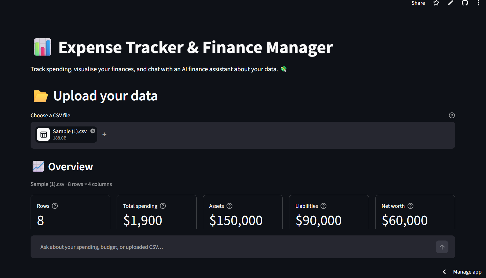
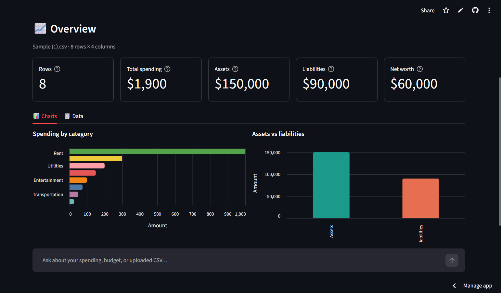
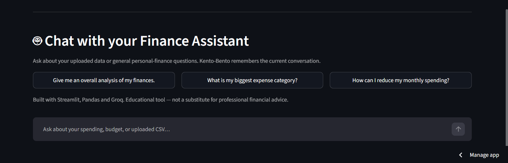
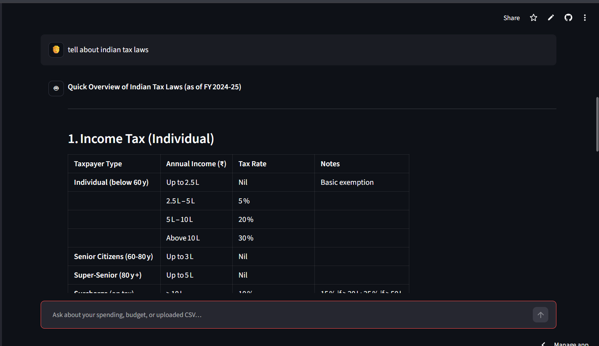

# 💼 Finance Manager Bot

An AI-powered personal finance dashboard built with **Streamlit**, **Pandas** and
**Groq** (via the official Groq SDK). Upload a CSV of expenses, assets or liabilities, explore
the charts, and ask questions about your data in plain English.

> Deployment: https://finance-manager-using-llm.streamlit.app/
>
> The live deployment may lag behind the current version of this repository.

## ✨ Features

- 📂 **CSV upload** with automatic cleaning
  - Case-insensitive column detection
  - Currency strings such as `$1,200.50`, commas and `(120)` negatives
  - Date parsing, blank-row removal and encoding fallbacks
- 📊 **Dashboard**
  - Spending by category
  - Assets vs liabilities
  - Monthly spending trend (when a date column is present)
  - KPI cards for spending, assets, liabilities and net worth
  - Downloadable cleaned data
- 🤖 **Finance chat**
  - Streaming responses
  - Conversation memory stored per session
  - Works with or without an uploaded CSV
  - Uses a compact, computed dataset brief instead of executing model-generated Python
- 🔒 **Safer by design**
  - No `create_csv_agent`, no arbitrary code execution
  - Direct Groq SDK integration instead of private LangChain internals
  - API keys read from environment variables or Streamlit secrets
  - Full CSV stays local; only a compact, computed brief is sent when you chat

## 📸 Screenshots

**Upload and overview**



**Dashboard**



**Finance chat**



**Example conversation**



## 🧱 Tech stack

| Layer | Technology |
| --- | --- |
| UI | Streamlit |
| Data | Pandas |
| Charts | Altair |
| LLM | Groq (`openai/gpt-oss-120b` by default) |
| LLM integration | Official Groq Python SDK (`groq`) |

## ⚙️ Installation

Requirements: **Python 3.10+** (3.11 or newer recommended).

```bash
git clone https://github.com/thxaman/Finance-Manager-Using-LLM
cd Finance-Manager-Using-LLM

python -m venv .venv
# Windows:
.venv\Scripts\activate
# macOS/Linux:
source .venv/bin/activate

pip install -r requirements.txt
```

Create a `.env` file in the project root:

```env
GROQ_API_KEY=your_groq_api_key_here
```

Get a free API key from [console.groq.com/keys](https://console.groq.com/keys).
An example file is provided at `.env.example`.

### Optional configuration

| Variable | Default | Purpose |
| --- | --- | --- |
| `GROQ_MODEL` | `openai/gpt-oss-120b` | Groq model ID |
| `GROQ_TEMPERATURE` | `0.2` | Response randomness |
| `CURRENCY_SYMBOL` | `$` | Symbol used in the dashboard and prompts |
| `MAX_HISTORY_MESSAGES` | `16` | Chat messages sent back to the model |
| `MAX_CONTEXT_CHARS` | `14000` | Maximum size of the dataset brief |
| `MAX_UPLOAD_MB` | `25` | Maximum CSV upload size |

Legacy `API_KEY_` and `API_KEY` environment variables are still read, so old
deployments continue to work.

### Streamlit secrets

For Streamlit Community Cloud, add this to `.streamlit/secrets.toml` (or the app's
secrets editor) instead of using `.env`:

```toml
GROQ_API_KEY = "your_groq_api_key_here"
```

## 🚀 Usage

```bash
streamlit run streamlit_app.py
# or
streamlit run app.py
```

Then:

1. Upload a CSV (or download `Sample.csv` from the sidebar and upload it).
2. Explore the overview and data tabs.
3. Ask questions in the chat, for example:
   - “Give me an overall analysis of my finances.”
   - “What is my biggest expense category?”
   - “What is my asset-to-liability ratio?”
   - “How can I reduce my monthly spending?”

### CSV format

`Category` and `Amount` are enough for the spending chart. Everything else is
optional:

```csv
Category,Amount,Date,Assets,Liabilities
Groceries,150,2025-01-05,150000,90000
Rent,1000,2025-01-06,,
Utilities,200,2025-01-07,,
```

Column matching is case-insensitive and also recognises common aliases such as
`Expense`, `Cost`, `Type`, `Transaction Date`, `Debt`, etc.

## 💻 Command-line chat

A small CLI is included for quick testing without Streamlit:

```bash
python test.py Sample.csv
```

Type `/clear` to reset the conversation and `/quit` to exit.

Run the tests without an API key:

```bash
python -m unittest discover -v
```

`test_data.py` covers CSV cleaning and totals; `test_model.py` covers message
history and streaming with a fake provider; `test_app.py` runs the Streamlit app
through `AppTest` with a fake model, so no network calls are made.

## 📁 Project structure

```text
app.py              Streamlit UI and dashboard
streamlit_app.py    Backwards-compatible entry point
model.py            Groq finance assistant and streaming client
data.py             CSV cleaning, summaries and dataset briefs
config.py           Settings, API-key handling and prompts
test.py             Interactive terminal chat
test_data.py        Data-layer unit tests
test_model.py       Assistant/history unit tests
test_app.py         Streamlit integration tests
assets/screenshots/ README screenshots
Sample.csv          Example dataset
.env.example        Example configuration
```

## 🔧 Troubleshooting

- **“No Groq API key found”** — check that `.env` exists in the project root (the
  file is git-ignored) or configure `GROQ_API_KEY` in Streamlit secrets.
- **Model not found / access denied** — set `GROQ_MODEL` to a model enabled for
  your Groq account. The default `openai/gpt-oss-120b` is a production model.
- **CSV columns not detected** — rename columns to `Category`, `Amount`, `Date`,
  `Assets` or `Liabilities`, or use one of the supported aliases.
- **Currency looks wrong** — set `CURRENCY_SYMBOL` (for example `₹`, `€` or `£`).

## 🔐 Security

- Never commit `.env` or Streamlit secrets. Both are ignored by `.gitignore`.
- If a key has ever been committed or shared, revoke it in the Groq console and
  create a new one.
- The assistant receives a compact dataset brief (totals, column summaries and a
  few sample rows), not the full file.

## 📜 License

This project is licensed under the MIT License — see the [LICENSE](LICENSE) file
for details.

## 📬 Contact

- **Aman Singh**: [amansingh010405@gmail.com](mailto:amansingh010405@gmail.com)
